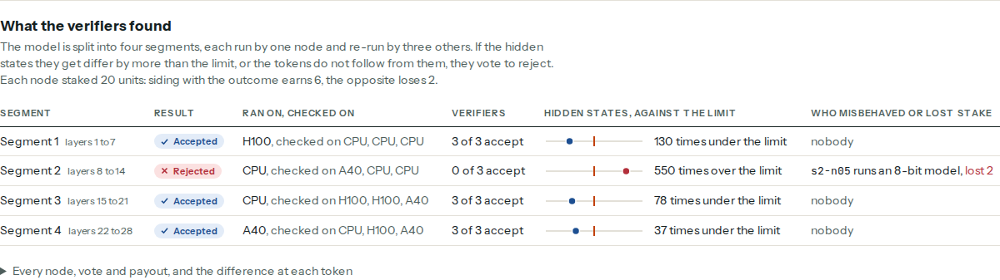
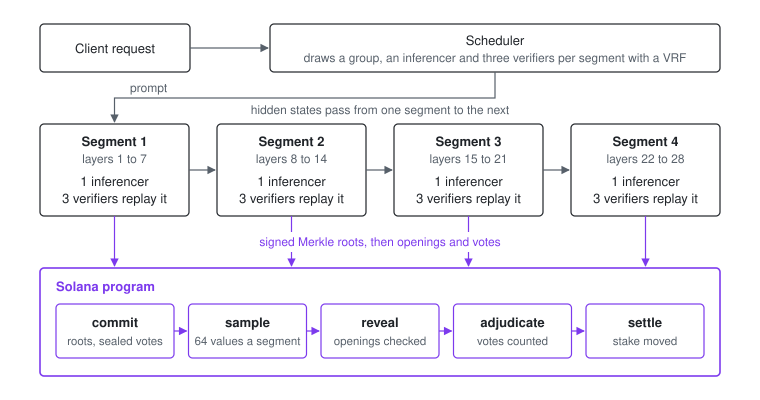

# verillm-solana

A working build of [VeriLLM: A Lightweight Framework for Publicly Verifiable
Decentralized Inference](https://arxiv.org/abs/2509.24257) (v4), with the
on-chain half written as a Solana program. The paper describes a way to check
that a node ran the model it claims to run: other nodes replay the answer and
compare hidden states, and a chain counts the votes and moves stake. We built
it step by step from Sections 5.2 to 5.7 and Appendices A and E, ran it on the
paper's model across three kinds of hardware, and kept the traces.

The write-up, with a demo that replays these runs, is at
[weightsnotwalls.com/blog/verillm-demo](https://www.weightsnotwalls.com/blog/verillm-demo).



## How it works

The model's layers are cut into segments. For each request a scheduler uses a
VRF to draw, per segment, one node to run it (the inferencer) and three to
check it (the verifiers). The inferencer signs a Merkle root over the hidden
states it produced. Each verifier takes the recorded inputs to that segment,
recomputes the whole answer in a single forward pass, compares the hidden
states and commits to a vote.

Only after the votes are sealed does the program sample which values to open.
It checks the openings against the committed roots, compares the sampled
values itself, counts the votes and pays or penalizes each node. An inferencer
that is rejected can appeal to a larger second committee.



## What we ran

The model is Qwen2.5-7B-Instruct at the revision the authors pin, in float32:
28 layers in 4 segments. There are 4 groups of 16 nodes, 1 inferencer and 3
verifiers drawn per segment, 11 verifiers in a second round, and 64 sampled
values per segment.

Nodes were spread over three kinds of machine: an AMD EPYC CPU, an NVIDIA A40
and an NVIDIA H100, the GPUs rented on RunPod. Honest results on different
hardware differed no more than a machine differs from itself. The worst mean
difference between any two was about 0.000015, against about 0.08 for the
8-bit segment, and no output token ever differed.

`runs/` holds seven recorded runs, with `index.json` listing them and
`calibration.json` holding the honest measurements the tolerances come from:

| Run | What happens |
| --- | --- |
| `honest` | Every node follows the protocol |
| `quantized` | One segment is served by an 8-bit model |
| `early-termination` | The last segment reports an end-of-sequence token early |
| `forged-output` | The answer is written by a 0.5B model; caught |
| `forged-accepted` | The same forgery, accepted when the colluding group also held two of three verifier seats |
| `lazy-verifier` | A verifier votes without doing the work |
| `dispute` | A captured committee rejects an honest answer and is overturned on appeal |

## What we found

The published code and the paper disagree on P_w. With the definition in the
authors' code, the P_w score for honest runs is 0.02 to 0.05 against a pass
mark of 0.80, so every honest run would fail. We follow the paper's text,
which names a second, looser tolerance, and report both numbers.

In the honest run, two honest verifiers on A40s voted to reject an honest
answer from an H100. One value out of 3,584 at one token had a different
exponent but an almost identical mantissa. The paper's P_m rule needs most
exponent mismatches to have a large mantissa difference, and here there was
exactly one mismatch, so the rule read it as cheating. The appeal fixed the
outcome (7 of 11 accepted), but the honest verifiers who voted to reject were
penalized.

A forged answer was accepted when the colluding group held all four inference
roles and two of three verifier seats on the last segment. The paper lets a
rejected inferencer appeal, but gives no way to challenge a wrong acceptance.

## Running it

You need Linux on x86-64, Python 3.12 with [uv](https://docs.astral.sh/uv/),
and Rust with the Solana build tools (`cargo build-sbf`). The paper's model
needs about 45 GB of memory and no GPU. Models are downloaded from Hugging
Face on first use.

```sh
uv venv --python 3.12 .venv
uv pip install --python .venv/bin/python --index-url https://download.pytorch.org/whl/cpu torch
uv pip install --python .venv/bin/python -r requirements.txt

solana/start.sh                       # build the program, start a local validator, deploy
(cd solana/program && cargo test)     # the program's logic, off chain
.venv/bin/python -m pytest            # chain tests are skipped without the validator

.venv/bin/python -m verillm.run --model small --out out/small   # quick pass on Qwen2.5-0.5B
.venv/bin/python -m verillm.run --model paper --out out/paper   # the full run
```

`--only quantized dispute` runs a subset of the scenarios.

To put nodes on other machines, start a worker on each and name them when
running. Each distinct device becomes a kind of hardware that nodes are
assigned to, alongside the local CPU.

```sh
# on each machine (install torch for its GPU instead of the CPU build)
VERILLM_TOKEN=some-shared-value python -m verillm.worker --model paper --device cuda --port 8000

# on the coordinator
VERILLM_TOKEN=some-shared-value .venv/bin/python -m verillm.run --model paper --out out/paper \
  --worker http://gpu-one:8000 --worker http://gpu-two:8000
```

`solana/start.sh` can be run again at any time. It fetches an Agave release
into `solana/.agave/`, makes a payer and a program keypair in `solana/.keys/`,
builds with `cargo build-sbf --arch v3`, starts `solana-test-validator` on
`http://127.0.0.1:8899` with its ledger in `/tmp/verillm-ledger`, and deploys.
Set `VERILLM_RPC_PORT` for another port and pass the same address to
`verillm.run` with `--rpc`. Neither the script nor the client uses the
machine's Solana CLI configuration or default keypair, and the client refuses
any address that is not local.

The program is deployed once. Each run picks a random 8-byte id, and every
account of that run is a program-derived address seeded with it, so runs do
not collide and nothing is reset between them.

## The code

| Path | What it is | Paper |
| --- | --- | --- |
| `verillm/model.py` | Qwen2 forward pass cut into slices, with cached decoding and one-pass prefill | 5.4 to 5.6 |
| `verillm/nodes.py` | The honest node and the adversaries | 5.5, Appendix A |
| `verillm/protocol.py` | Scheduler, relay, verification, sampling, dispute, settlement | 5.1 to 5.7 |
| `verillm/scenarios.py`, `run.py` | The seven scenarios, calibration and the entry point | Appendix A |
| `verillm/stats.py` | The hidden-state comparison tests | 5.7, 7 |
| `verillm/merkle.py`, `hashing.py`, `ecvrf.py` | Merkle commitments, the HKDF stream, the VRF | 5.4, Appendix D |
| `verillm/chain.py`, `layout.py` | Client for the program: builds, sends and reads back every transaction | Appendix D |
| `verillm/worker.py`, `remote.py` | A node's model on another machine, over HTTP | 5.5 |
| `solana/program/src/lib.rs` | Instruction dispatch; handlers in `registry.rs`, `roles.rs`, `verification.rs`, `adjudication.rs`, `settlement.rs` | 5.2 to 5.7, Appendix E |
| `solana/program/src/vrf.rs` | ECVRF verification with the curve25519 syscalls | 5.4, Appendix D |
| `solana/program/src/math.rs` | HKDF stream, permutation, sampling, Merkle checks, the fixed-point comparison | 5.4, 5.7, 7 |
| `solana/program/src/state.rs` | Account layouts | |

`cargo test` checks the VRF verifier against the RFC 9381 vectors, and the
stream, permutation, sampling and Merkle code against values written by the
Python. `tests/test_chain.py` runs the whole protocol through the deployed
program on small made-up tensors.

## On chain

The program is native Rust, run on a local test validator. It uses v1
transactions, which hold 4,096 bytes. A normal run sends 167 transactions, and
288 with an appeal. One reveal is 8 transactions, because the 64 openings with
their Merkle paths come to about 25 KB; each chunk is checked as it arrives
against the stored root and the indices the program derived.

The VRF is ECVRF-EDWARDS25519-SHA512-TAI from RFC 9381. The paper uses the
P-256 suite of the same RFC, but Solana has syscalls for curve25519 and none
for P-256. One verification costs about 50,000 compute units. Signatures on
roots are checked by the native Ed25519 program: the transaction carries that
instruction, and the program reads the instructions sysvar to confirm it sits
just before its own and covers the registered key and the expected message.

## Where the paper leaves things open

Each of these is marked in the code where the choice is made.

- Merkle tree. A leaf is keccak256(0x00, the scalar as 4 big-endian bytes), a
  node is keccak256(0x01, left, right), padded to a power of two. The paper
  says Keccak-256 in one place and SHA-256 in another.
- What the inferencer commits. One root per segment over that segment's
  per-step roots. The final-step root is opened against it at sampling time,
  so it is fixed before verifiers commit and hidden until they have.
- Random stream. HKDF-SHA256 read as 64-bit words, reduced modulo the range.
  The sampling policy is one index from each of n equal strata.
- P_e, P_m, P_w. As in the authors' experiment code, except that P_w uses the
  tolerance e_w from the paper's text (see `verillm/stats.py`).
- Tolerances tau, epsilon, theta. Not given. tau and epsilon are calibrated
  from honest runs as the paper prescribes, at ten times the worst honest
  value; theta is 0.95.
- Adjudication. Section 5.7 and Appendix E describe it differently. The
  program clusters verifiers by agreement (Appendix E), needs a quorum, then
  takes the cluster's vote (Section 5.7).
- Vote commitments include the verifier's public key, or one verifier could
  replay another's.
- Rewards come from a pool funded when a run is set up. The paper does not say
  who pays.
- Keys. A node's Ed25519 signing key is also its Solana address. The
  scheduler's VRF key is separate.
- Time. A local validator's clock cannot be moved forward, so the dispute
  window is 3 seconds and settlement waits it out. Phase deadlines stay at an
  hour.
- Money. Stakes, rewards and penalties are in lamports, one unit being 0.01
  SOL, held in the run's config account with a per-node ledger.

## Not built

The zero-knowledge appeal (the paper does not specify it), role anonymity, and
fraud proofs against the scheduler. Verifiers see the prompt, so there is no
privacy here; confidential hardware (TEEs) is the complementary approach.

## Known gaps

- After a first round with no consensus, a rejected second round penalizes
  every first-round verifier.
- A worker never drops finished sessions.
- A node receiving hidden states checks the scheduler's relay signature and
  the Merkle root, but not the producing node's signature.
- `adjudicate` and `settle` can be called by anyone.
- The worker listens on all interfaces, and its bearer token is optional.

## License

MIT. See [LICENSE](LICENSE).
